<p><h1 align="center">S004.基于微信小程序的健康饮食推荐系统【含报告文档】</h1></p>

###  获取完整源码和sql数据库文件（完全免费）:  微信: littlepinia88 qq：1104515926
###  所有项目以及源代码本人均调试运行无问题 可支持远程安装部署调试、定制修改、代码讲解

## 简介

> 本代码来源于网络,仅供学习参考使用!
>
> 提供1.远程部署/2.修改代码/3.设计文档指导/4.框架代码讲解等服务
>
> 访问地址：http://localhost:8080/weiyinshi/admin/login.jsp
> 
> 管理员：admin 123456
> 
> 用户：1 1
>

## 项目介绍
本项目是一个基于微信小程序与 Java 后端的健康饮食推荐系统，面向个人日常饮食、运动、睡眠打卡与健康内容社区场景，采用「uni-app 编译的微信小程序（用户端）+ JSP 后台管理系统」双端结构，打通了会员注册登录、健康资讯浏览、论坛动态、健康活动报名、饮食、运动、睡眠打卡、个人健康计划、后台内容与会员管理的业务闭环。后端以 Spring Boot 同时提供小程序 REST 接口与后台管理页面，可作为微信小程序加 Java 后端的全栈实践案例。

### 系统角色
- **小程序会员**：注册登录小程序，浏览健康资讯、论坛动态与健康活动，发布饮食、运动、睡眠打卡日志与动态，报名活动，维护个人健康计划。
- **管理员**：通过后台 Web 登录，管理会员、资讯栏目与文章、活动、动态、各类打卡日志、轮播图与留言。
- **权限控制**：管理员登录（`/admin/login`）成功后将管理员对象写入 HttpSession；小程序会员走 `/admin/huiyuan/login`、`/admin/huiyuan/wxlogin` 登录与注册接口，业务接口统一以 `/admin/**` 暴露。

### 小程序功能
1. **首页与资讯**：轮播图、栏目导航、健康资讯列表与详情、全站搜索。
2. **论坛社区**：动态列表与详情、发表评论、发布个人动态。
3. **健康活动**：活动列表与详情、在线报名、我的报名管理。
4. **健康打卡**：饮食日志、运动日志、睡眠日志的添加与管理。
5. **健康计划**：制定与管理个人健康计划，查看计划详情。
6. **个人中心**：资料修改、修改密码、头像上传、账户充值、留言管理、我的消息。

### 管理端功能
1. **管理员登录**：独立后台登录页 `admin/login.jsp`，登录后进入管理首页。
2. **会员管理**：小程序会员的查询、新增、编辑、拉黑与恢复。
3. **内容管理**：资讯栏目（`lanmu`）与资讯（`xinxi`）、轮播图（`jiaodiantu`）、页面设置的维护。
4. **活动与社区**：活动类型（`acttype`）与活动（`activity`）、活动报名（`actjoin`）、论坛动态（`dynamic`）的管理。
5. **打卡日志管理**：饮食、运动、睡眠三类日志的查看与管理。
6. **其他**：留言管理、系统角色（`sysrole`）与管理员账号（`users`）维护。

### 技术栈
- **后端框架**：Spring Boot 2.2.2.RELEASE、Spring MVC、MyBatis（mybatis-spring-boot-starter 1.3.2）
- **数据访问**：MySQL 5.1.37 驱动，库 `s004_weiyinshi`；HikariCP 连接池（pom 另声明 Druid）；PageHelper 1.3.0 分页
- **小程序端**：uni-app 编译产物在 `mp-weixin/`，使用 uni-ui 组件库，请求基址 `http://localhost:8080/weiyinshi`
- **后台端**：JSP（tomcat-embed-jasper + JSTL），页面基于 Bootstrap、jQuery、Vue 与 ECharts
- **工程能力**：本地 system 依赖 `simple-dev-2.0.2.jar` 通用 CRUD 框架、Fastjson、POI、commons-fileupload 文件上传

### 核心数据表
- `users` 管理员表、`sysrole` 系统角色表
- `huiyuan` 小程序会员表：账号、密码、昵称、头像、余额
- `xinxi` 资讯表、`lanmu` 栏目表、`jiaodiantu` 轮播图表、`notice` 公告表
- `activity` 活动表、`acttype` 活动类型表、`actjoin` 活动报名表
- `dynamic` 论坛动态表、`comment` 评论表
- `eatlog` 饮食日志表、`sportlog` 运动日志表、`sleeplog` 睡眠日志表、`myplan` 个人计划表、`leaveword` 留言表

### 工程结构
```
S004HealthyDietRecommendationSystem
├── mp-weixin/               微信小程序（uni-app 编译产物）
│   ├── pages/e/             首页、资讯、活动、论坛、搜索等页面
│   │   └── huiyuan/         会员个人中心（打卡、计划、资料、充值）
│   ├── components/         uni-ui 等自定义组件
│   ├── app.js / app.json    小程序入口、页面注册与 tabBar 配置
│   └── common/main.js       请求基址 http://localhost:8080/weiyinshi
├── weiyinshi/               后端 Spring Boot 工程
│   └── src/main
│       ├── java/com/daowen
│       │   ├── controller/  小程序接口与后台控制器
│       │   ├── service/ dao/ entity/ mapper/
│       │   └── util/ configuration/
│       ├── conf/mybatis/   MyBatis Mapper XML
│       ├── resources/application.properties  端口 8080、context-path /weiyinshi
│       └── webapp
│           ├── admin/       后台管理 JSP 页面
│           ├── webui/       Bootstrap、jQuery、Vue、ECharts 后台静态资源
│           └── upload/      上传文件目录
└── screenshot/              运行截图
```

### 补充说明
- 端口 8080、上下文 `/weiyinshi`、库名 `s004_weiyinshi` 见 `application.properties`，需先建库并导入 SQL。
- 小程序请求基址硬编码为 `http://localhost:8080/weiyinshi`（`mp-weixin/common/main.js`），真机调试需改为服务器地址。
- 原文介绍中的「体检」在源码中无对应模块；密码明文比对、无统一鉴权拦截，仅用于教学演示。

## 环境

- <b>IntelliJ IDEA 2021.3</b>

- <b>Mysql 5.7.26</b>

- <b>微信开发者工具</b>

- <b>JDK 1.8</b>

## 运行截图
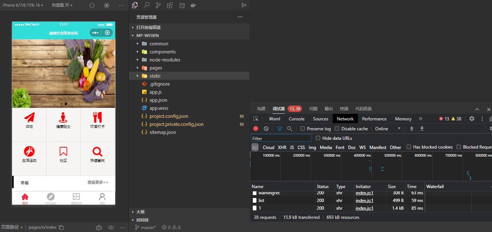

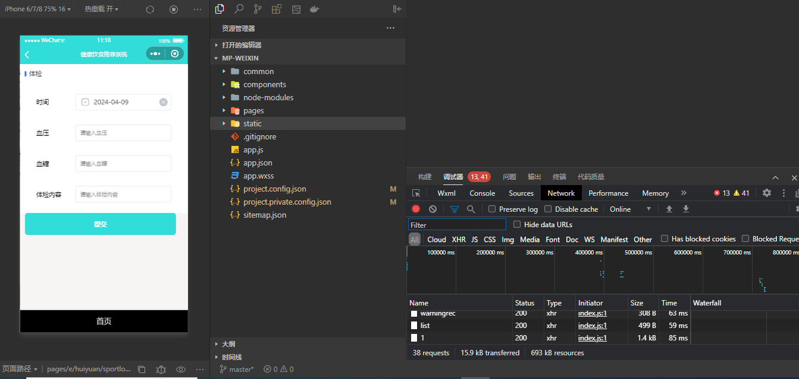

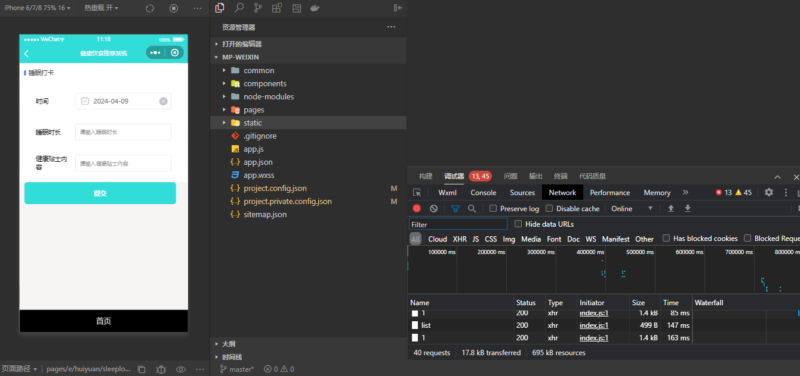

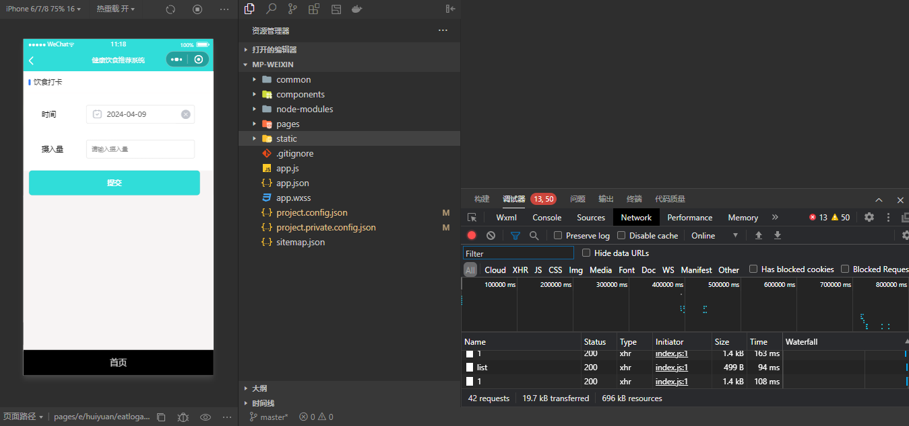

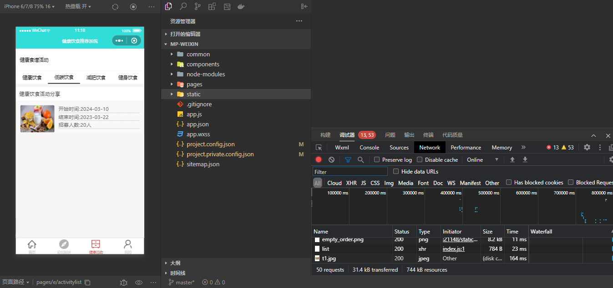

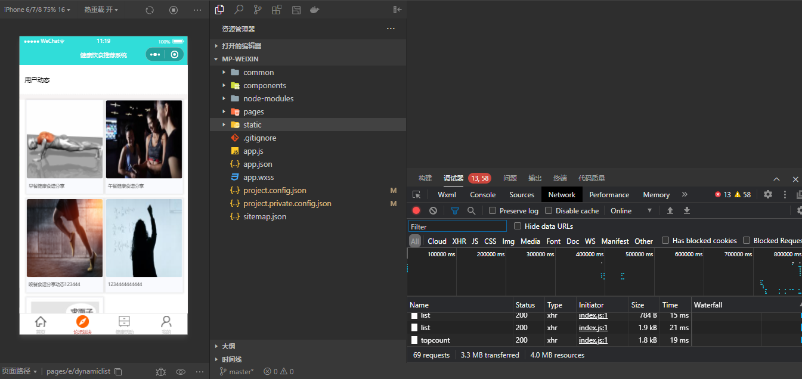

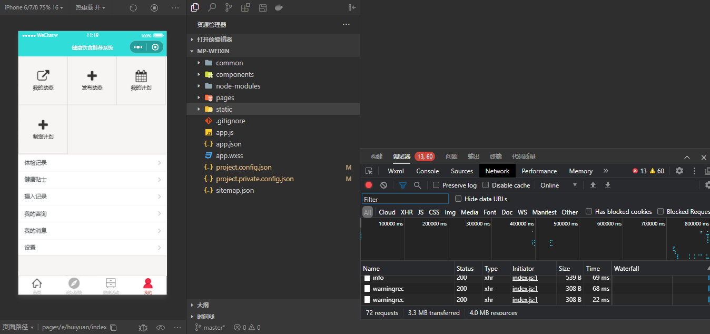

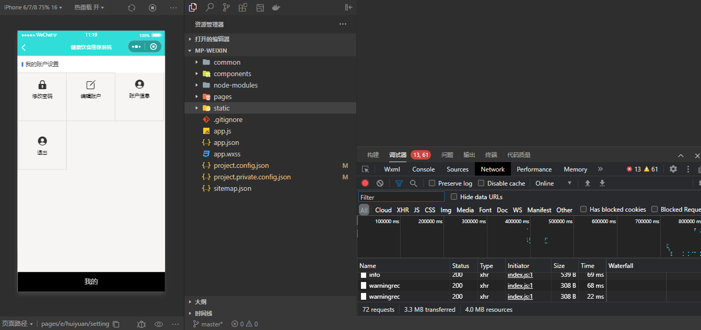

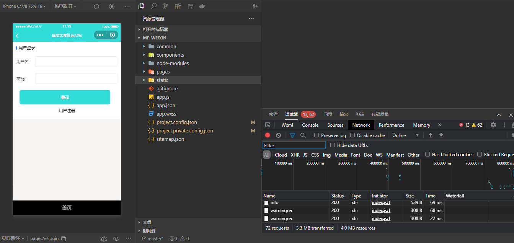

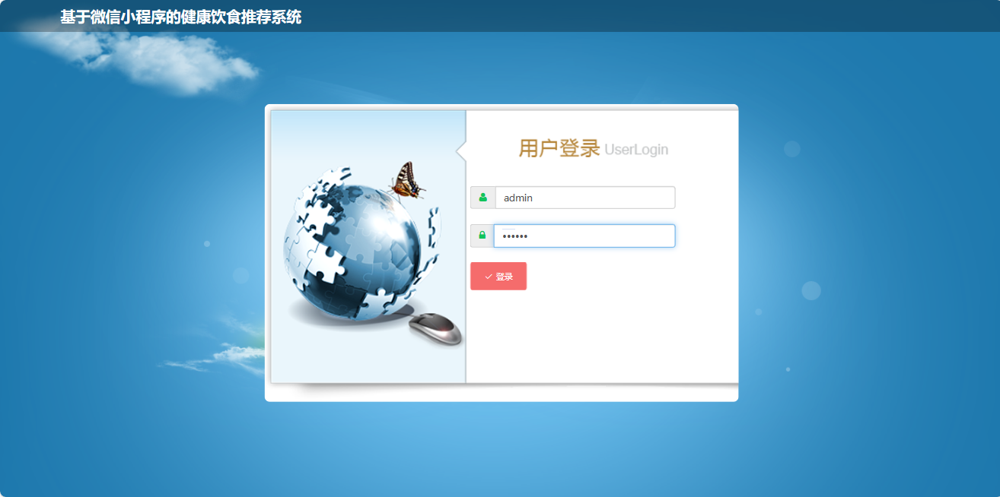

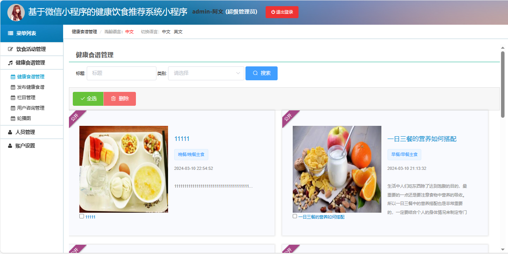

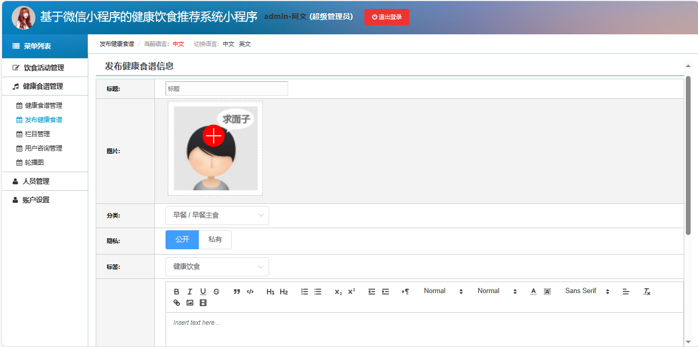

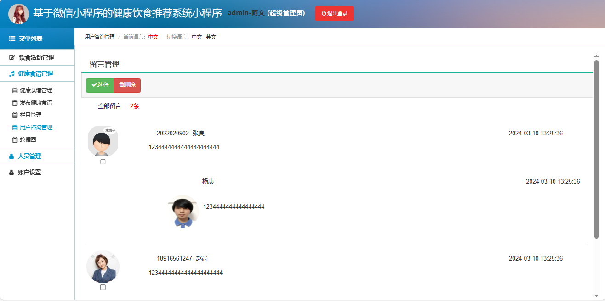